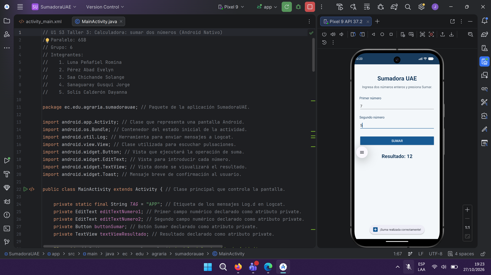
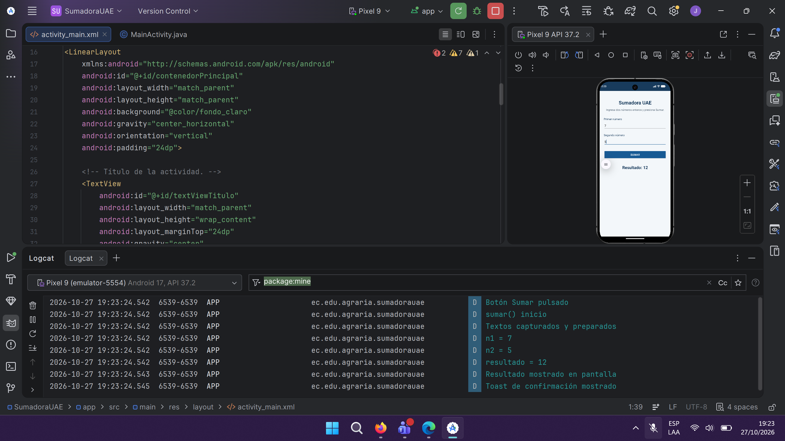
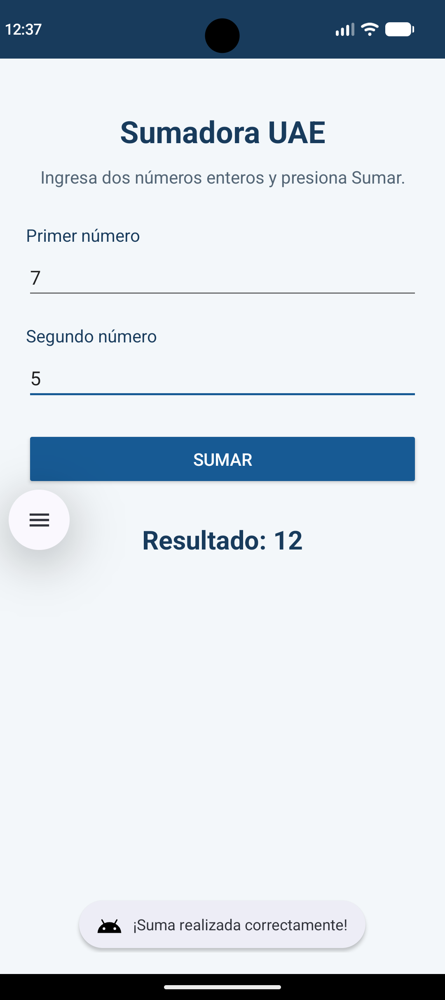

# U1 S3 Taller 3: Calculadora: sumar dos números (Android Nativo)

**Materia:** Lenguaje de Programación 5  
**Paralelo:** 6SB  
**Grupo:** 6

## Integrantes

1. Luna Peñafiel Romina
2. Pérez Abad Evelyn
3. Saa Chichande Solange
4. Sanaguaray Gusqui Jorge
5. Solís Calderón Dayanna

## Descripción

**SumadoraUAE** es una aplicación Android nativa desarrollada con **Java y XML** en Android Studio. Permite ingresar dos números enteros, sumarlos y mostrar el resultado en pantalla. También utiliza validaciones, mensajes **Toast** y registros **Logcat**.

## Capturas de pantalla

### 1. Código Java y aplicación en el emulador

### 2. Diseño XML y registros de Logcat

### 3. Resultado de la suma

**Ejemplo:** 7 + 5 = **12**.
